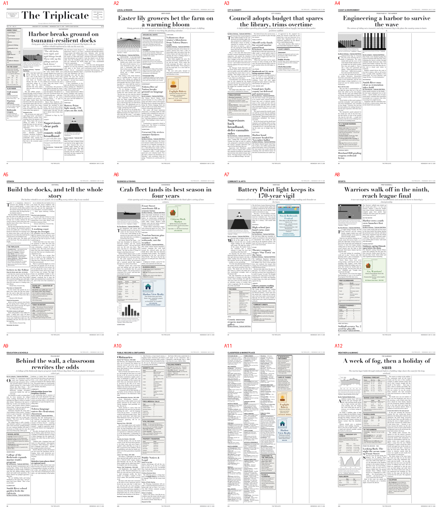

# The Triplicate — `template_newspaper`

Render a 12-page US Tabloid newspaper (11″ × 17″) from structured YAML using
ReportLab. The included *Triplicate* edition is a fictional specimen inspired
by the Crescent City newspaper. Broadsheet is also supported.

- [Documentation index](docs/README.md)
- [Build and verify the edition and manuscript](docs/quickstart.md)
- [Edition contents and layout](docs/edition.md)
- [Manuscript on the layout engine](docs/manuscript/README.md)

## Publication status

See the [publication instructions](docs/publishing.md) for the source metadata
and status report command.

<!-- PUBLISHING-STATUS:START (generated by infrastructure.publishing.status_report) -->
**The Triplicate: A Data-Driven Large-Format Newspaper Layout Engine** · v1.0.2 · MIT · Daniel Ari Friedman

Concept DOI: [10.5281/zenodo.20533675](https://doi.org/10.5281/zenodo.20533675) | Version DOI: [10.5281/zenodo.20932039](https://zenodo.org/records/20932039) | Repository: [docxology/template_newspaper](https://github.com/docxology/template_newspaper)

Publishing surface — 20 platforms, 9 published:

| Platform | Tier | Status | Reference | Credentials |
| --- | --- | --- | --- | --- |
| zenodo | first-class | ✅ published | [10.5281/zenodo.20533675](https://doi.org/10.5281/zenodo.20533675) | `ZENODO_API_TOKEN` |
| github | first-class | ✅ published | [docxology/template_newspaper](https://github.com/docxology/template_newspaper) | `GITHUB_TOKEN` |
| arxiv | first-class | ⚪ available | — | — |
| pypi | first-class | ✅ published | [https://test.pypi.org/project/template-newspaper/1.0.2/](https://test.pypi.org/project/template-newspaper/1.0.2/) | `PYPI_TOKEN`, `TESTPYPI_TOKEN` |
| ipfs_pinata | first-class | ✅ published | [https://gateway.pinata.cloud/ipfs/QmUsept2d9X3sz42whTgEGM9TjdxjzSqxnuyPCbu3pPwku](https://gateway.pinata.cloud/ipfs/QmUsept2d9X3sz42whTgEGM9TjdxjzSqxnuyPCbu3pPwku) | `PINATA_JWT` |
| ipfs_web3storage | first-class | ⚪ available | — | `WEB3_STORAGE_TOKEN` |
| software_heritage | first-class | ✅ published | [https://archive.softwareheritage.org/browse/origin/?origin_url=https://github.com/docxology/template_newspaper](https://archive.softwareheritage.org/browse/origin/?origin_url=https://github.com/docxology/template_newspaper) | — |
| github_pages | first-class | ✅ published | [https://docxology.github.io/template_newspaper/](https://docxology.github.io/template_newspaper/) | `GITHUB_TOKEN` |
| cloudflare_pages | first-class | ⚪ available | — | `CLOUDFLARE_API_TOKEN` |
| netlify | first-class | ✅ published | [https://6a4441f8d6dc10153d77788d--tranquil-kleicha-0c9203.netlify.app](https://6a4441f8d6dc10153d77788d--tranquil-kleicha-0c9203.netlify.app) | `NETLIFY_AUTH_TOKEN` |
| huggingface_hub | first-class | ✅ published | [https://huggingface.co/datasets/ActiveInference/template_newspaper](https://huggingface.co/datasets/ActiveInference/template_newspaper) | `HUGGINGFACE_TOKEN`, `HF_TOKEN` |
| osf | first-class | ✅ published | [https://osf.io/tzwf8/](https://osf.io/tzwf8/) | `OSF_TOKEN` |
| amazon_kdp | documented | 🟡 planned | — | `AMAZON_KDP_EMAIL`, `AMAZON_KDP_PASSWORD` |
| google_play_books | documented | 🟡 planned | — | `GOOGLE_PLAY_BOOKS_SERVICE_ACCOUNT_JSON` |
| gumroad | documented | 🟡 planned | — | `GUMROAD_ACCESS_TOKEN` |
| leanpub | documented | 🟡 planned | — | `LEANPUB_API_KEY` |
| lulu | documented | 🟡 planned | — | `LULU_CLIENT_KEY`, `LULU_CLIENT_SECRET` |
| draft2digital | documented | 🟡 planned | — | `DRAFT2DIGITAL_API_TOKEN` |
| stripe | documented | 🟡 planned | — | `STRIPE_SECRET_KEY`, `STRIPE_PUBLISHABLE_KEY` |
| ingramspark | documented | 🟡 planned | — | `INGRAMSPARK_CLIENT_ID`, `INGRAMSPARK_CLIENT_SECRET` |

_Keywords: newspaper layout, typography, reportlab, reproducible publishing, document engineering._

_Status legend: ✅ published (durable identifier recorded in `config.yaml`) · 🔵 reserved (identifier reserved but not yet registered by final publication) · ⚪ available (adapter implemented and locally verifiable) · 🟡 planned. This block is generated — See the publication instructions to regenerate it._
<!-- PUBLISHING-STATUS:END -->
